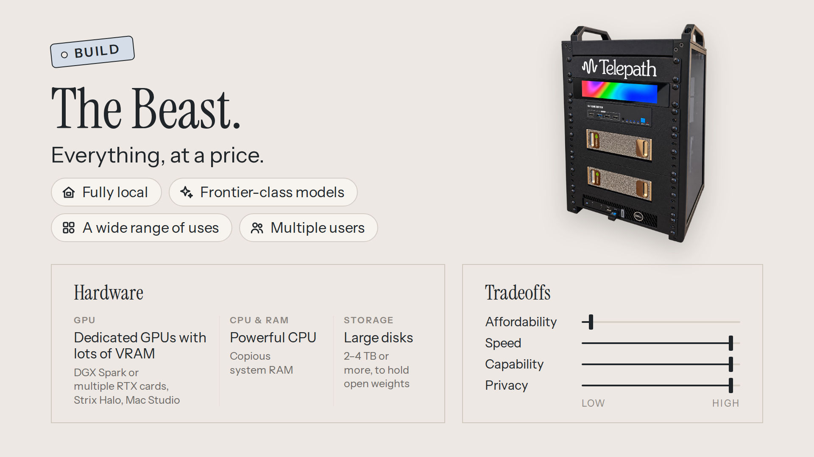
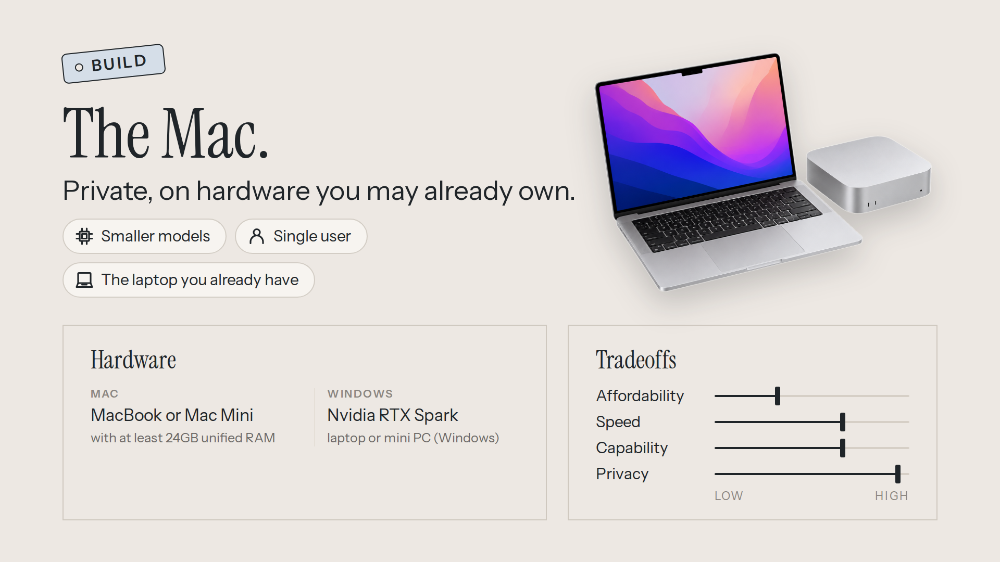
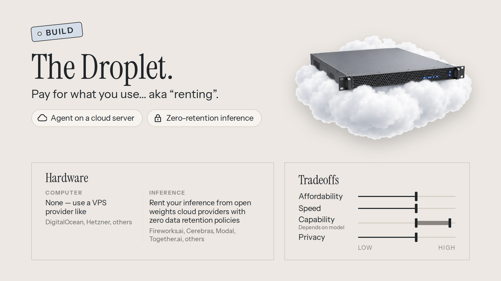
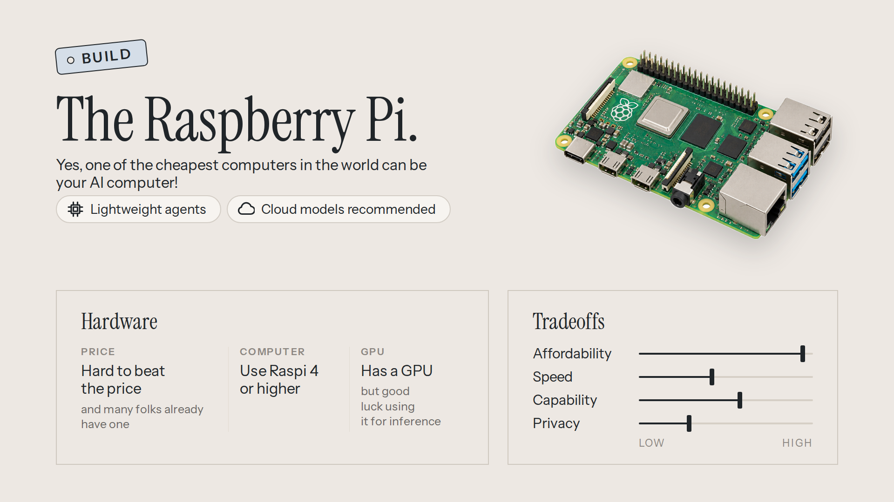
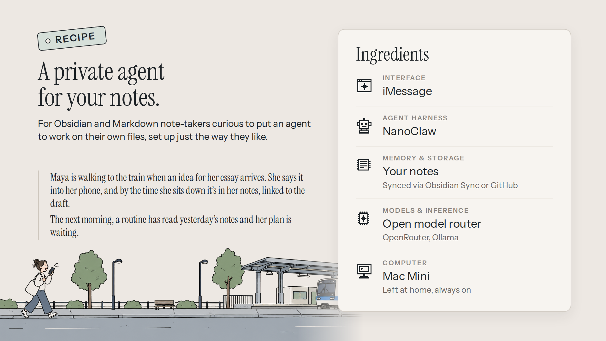
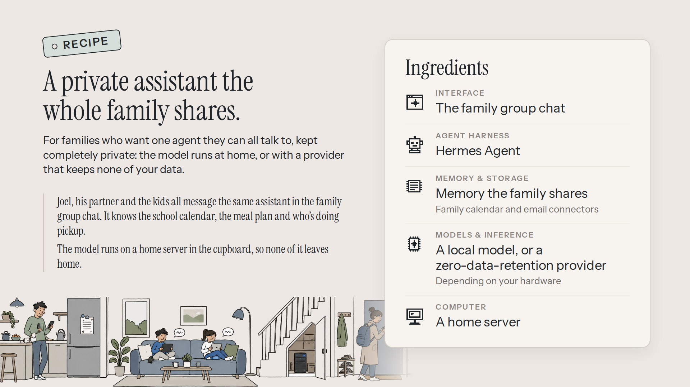
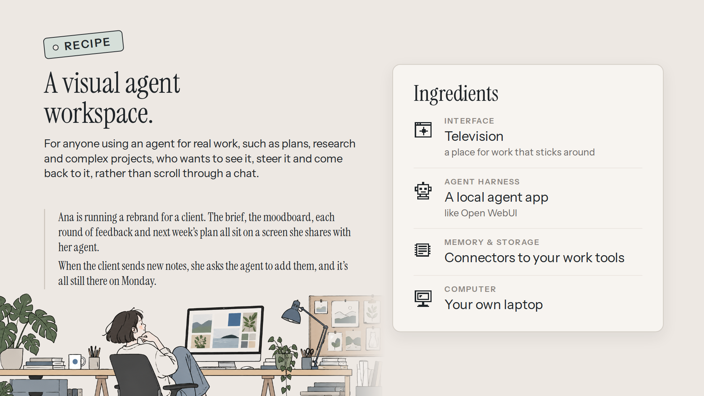
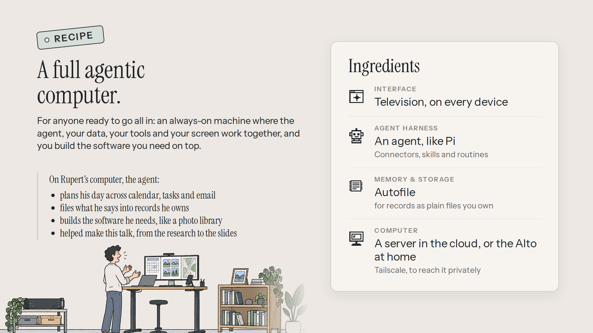

# AI Computer Cookbook

**A curated list of resources, links, and materials for making your very own open-source AI computer.**

## Contents

- [Inference engines](#inference-engines)
- [Models](#models)
- [Memory & storage systems](#memory--storage-systems)
- [Agent harnesses](#agent-harnesses)
- [Interfaces](#interfaces)
- [Builds](#builds)
- [Recipes](#recipes)

## Inference engines
- [llama.cpp](https://github.com/ggml-org/llama.cpp)
- [vLLM](https://vllm.ai/)
- [Llamafile](https://llamafile.ai/)
- [Ollama](https://ollama.com/)
- [TensorFold](https://github.com/ashhart/TensorFold)
- [Halogen](https://github.com/peonist-ai/halogen-flash-server)
- [Strata](https://github.com/Niko1221/Strata)
- [Mia's AI Lab](https://mia-ai.net/) (useful recipes for getting models running on Nvidia Spark and RTX)

## Models
- [GLM 5.3 Flash](https://huggingface.co/zai-org/GLM-5.3-Flash)
- [DeepSeek 4.1 Flash 1017](https://huggingface.co/deepseek-ai/DeepSeek-V4.1-Flash-1017)
- [Qwen 3.8 Flash Next](https://huggingface.co/Qwen/Qwen3.8-Flash-Next)
- [Nemotron 3.5 Lightning](https://huggingface.co/nvidia/NVIDIA-Nemotron-3.5-Lightning-30B-A3B-NVFP4)
- [Nemotron 3.5 Bolt](https://huggingface.co/nvidia/NVIDIA-Nemotron-3.5-Bolt-74B-A9B-24GB)
- [Inkling](https://huggingface.co/thinkingmachines/Inkling)
- [Muse Glimmer](https://huggingface.co/meta-models/Muse-Glimmer-30B)
- [Gemma 4](https://huggingface.co/google/gemma-4-31B-it)
- [Kimi](https://huggingface.co/moonshotai)
- [Mistral](https://huggingface.co/mistralai)

## Memory & storage systems
- [Autofile](https://github.com/telepath-computer/autofile)
- [Honcho](https://honcho.dev/)
- [GBrain](https://gbrain.io/)
- [mem0](https://mem0.ai/)
- [OpenViking](https://github.com/volcengine/OpenViking)
- [Solstone](https://solstone.app/)
- [Hindsight](https://github.com/vectorize-io/hindsight)
  
## Agent harnesses
- [Hermes Agent](https://hermes-agent.nousresearch.com/)
- [OpenClaw](https://openclaw.ai/)
- [NanoClaw](https://nanoclaw.dev/)
- [Pi](https://pi.dev/)
- [OpenCode](https://opencode.ai/)
- [Thunderbolt](https://www.thunderbolt.io/)

## Interfaces

### Graphical environments
- [Television](https://television.run)

### Chat-based apps
- [Open WebUI](https://github.com/open-webui/open-webui)
- [Goose](https://block.github.io/goose/)
- [Thunderbolt](https://www.thunderbolt.io/)
- [Hermes Desktop](https://hermes-agent.nousresearch.com/desktop)
- [Tiles](https://tiles.run)

## Builds
These are example configurations for AI PCs.

### The Beast

- In a nutshell: dedicated GPU hardware and large amounts of RAM (either VRAM or unified RAM), enabling you to run large, frontier-class models locally.
- Hardware:
  - Nvidia DGX Spark, Nvidia RTX 3000/4000/5000 series cards (likely multiple), AMD Strix Halo, or a Mac Studio.
  - Ideally paired with a dedicated separate machine to run the agent (so that it doesn't eat into available RAM for inference).
  - A large amount of storage (2-4 TB+) to store large model weights.

### The Mac

- In a nutshell: use the MacBook or Mac Mini you already have to run smaller but capable models locally, preserving your privacy and control.
- Hardware:
  - Apple Silicon (M1+) MacBook Air, MacBook Pro, Mac Mini, or iMac with at least 24GB of unified RAM.
  - On Windows: an Nvidia RTX Spark laptop or mini PC.
- Notes:
  - If you use a laptop, your agent will shut down when you close the lid.
  - Be extremely cautious when running an agent harness on your primary machine. Recommend running in a container and ensuring that any "yolo mode" is turned off.

### The Droplet

- In a nutshell: run your agent and your model in the cloud, avoiding the need to manage any hardware at all.
- Services:
  - Cloud VPS: Use DigitalOcean, Hetzner, or other VPS server to run your agent harness; many offer a one-click setup option for this.
  - Cloud inference: Use a provider like Fireworks.AI, Cerebras, Modal, or Together.AI to provide inference on the cloud model of your choice.
- Notes:
  - Set maximum spending caps for your cloud inference providers, or look for a provider who offers a flat monthly subscription rate; you don't want to get caught by surprise with a big bill if your agent uses a lot of tokens.

### The Raspberry Pi

- In a nutshell: yes, you can use one of the world's cheapest computers as an AI personal computer, with a few compromises.
- Hardware:
  - Raspberry Pi 4 or higher.
- Services:
  - A cloud inference provider, as above.
- Notes:
  - Very small (<1B parameters) models exist that will run on Raspis, but they are very slow and have limited capabilities.
  - The Raspi has a GPU but getting it to work can be difficult; expect that any inference you run locally will be CPU-based.

## Recipes
Example setups for particular people, with the ingredients for each layer of the stack.

### A private agent for your notes

- For Obsidian and Markdown note-takers curious to put an agent to work on their own files, set up just the way they like.
- Ingredients:
  - Interface: iMessage.
  - Agent harness: NanoClaw.
  - Memory & storage: your notes, synced via Obsidian Sync or GitHub.
  - Models & inference: an open model router, such as OpenRouter or Ollama.
  - Computer: a Mac Mini, left at home and always on.

### A private assistant the whole family shares

- For families who want one agent they can all talk to, kept completely private: the model runs at home, or with a provider that keeps none of your data.
- Ingredients:
  - Interface: the family group chat.
  - Agent harness: Hermes Agent.
  - Memory & storage: memory the family shares, with family calendar and email connectors.
  - Models & inference: a local model or a zero-data-retention provider, depending on your hardware.
  - Computer: a home server.

### A visual agent workspace

- For anyone using an agent for real work, such as plans, research and complex projects, who wants to see it, steer it and come back to it, rather than scroll through a chat.
- Ingredients:
  - Interface: Television, a place for work that sticks around.
  - Agent harness: a local agent app, like Open WebUI.
  - Memory & storage: connectors to your work tools.
  - Computer: your own laptop.

### A full agentic computer

- For anyone ready to go all in: an always-on machine where the agent, your data, your tools and your screen work together, and you build the software you need on top.
- Ingredients:
  - Interface: Television, on every device.
  - Agent harness: an agent like Pi, with connectors, skills and routines.
  - Memory & storage: Autofile, for records as plain files you own.
  - Computer: a server in the cloud, or the Alto at home, reached privately with Tailscale.
